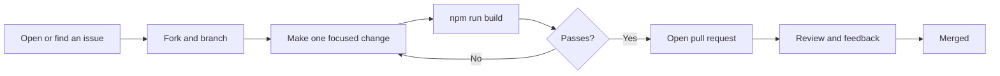

<p align="center">
  
</p>

<p align="center">
  Thank you for helping improve <b>PaperTrail</b>.<br>
  This guide covers setup, what we care about in design and code, and how to submit a change.
</p>

<p align="center">
  <a href="#-quick-start">Quick start</a> ·
  <a href="#-how-to-contribute">Workflow</a> ·
  <a href="#-design-principles">Design</a> ·
  <a href="#-motion-and-animation-guidelines">Motion</a> ·
  <a href="#-honesty-about-research-data">Data honesty</a> ·
  <a href="#-pull-request-checklist">PR checklist</a>
</p>

<p align="center"></p>

## 🚀 Quick start

Requires **Node.js 18 or newer**.

```bash
# 1. Fork the repo on GitHub, then clone your fork
git clone https://github.com/<your-username>/PaperTrail.git
cd PaperTrail

# 2. Create a focused branch
git checkout -b fix/map-label-overlap

# 3. Install and run
npm install
npm run dev        # http://localhost:5173

# 4. Before you open a pull request
npm run build      # must pass
```

## 🧭 How to contribute

<p align="center">
  
</p>



Not sure where to start? Look for issues labelled `good first issue`, or pick something from the ideas below.

<details>
<summary><b>💡 Ideas for contributions</b></summary>

- Metadata lookup through Crossref or OpenAlex (no paid keys required)
- BibTeX or CSV export of the library
- Editing and deleting papers
- Persistent storage beyond `localStorage`
- Keyboard shortcuts and screen-reader improvements
- A dark theme that keeps the editorial feel
- More empty-state illustrations (original work only)

</details>

## 🗂 Project layout

| Path | What lives there |
| --- | --- |
| `src/App.jsx` | Hash routing, global state, modals and toasts |
| `src/views/` | One file per page: Overview, Library, Connections, Gaps, Shelf |
| `src/components/` | Reusable pieces: Nav, PaperCard, PaperDetail, AddPaper, CitationMap, UI primitives |
| `src/lib/` | Pure logic (graph layout and analysis) and persistence hooks |
| `src/data/seed.js` | Demonstration records, collections and sample research directions |
| `src/styles/` | `tokens.css` (colours, type, spacing) and `app.css` |
| `public/brand/` | Logo, icon, light logo and favicon (SVG) |
| `public/images/` | Original in-app illustrations |
| `docs/` | README and CONTRIBUTING banner, workflow and divider SVGs |
| `images/` | README screenshots |

## 🎨 Design principles

- **Editorial and calm.** Warm ivory surfaces, forest green as the primary colour, terracotta as a sparing accent. Use the variables in `src/styles/tokens.css` instead of hard-coded values.
- **Serif for editorial headings, sans-serif for the interface.** Keep metadata (labels, years, DOIs) quiet and titles prominent.
- **Horizontal navigation.** Please do not add a sidebar.
- **Everything interactive must work.** No placeholder buttons and no loading states that never finish.
- **Avoid generic AI-dashboard patterns:** purple gradients, glow effects, cards around everything, and meaningless statistics.

| Token | Value | Use |
| --- | --- | --- |
| `--ivory` | `#f6f2e8` | Page background |
| `--forest` | `#1f4d3a` | Primary brand colour, actions |
| `--terra` | `#b95c35` | Accent, used sparingly |
| `--ink` | `#1d2a24` | Main text |
| `--serif` | Lora | Editorial headings |
| `--sans` | DM Sans | Interface text |

## ✨ Motion and animation guidelines

Animation should make PaperTrail feel responsive, not busy. Before adding any, ask what it communicates.

**Do**

- Use motion for feedback (a bookmark that springs when saved), navigation (the sliding active tab) and storytelling (citation edges drawing in).
- Keep durations short: about 150 to 300 ms for interface feedback, up to about 700 ms for entrance or drawing effects.
- Stagger collections gently, with delays capped at about 0.3 s in total.
- Animate `opacity` and `transform` where possible. They are cheap for the browser.
- Use Framer Motion for component animation and CSS transitions for simple hover states.

**Don't**

- Loop decorative animations on the main interface. A skeleton shimmer or a loading bar is fine, because it communicates progress.
- Animate layout properties such as `width` or `top` on large areas.
- Hide important information behind an animation.

**Reduced motion is required**

Every animation must still work for people who set `prefers-reduced-motion: reduce`. The app wraps itself in Framer Motion's `MotionConfig reducedMotion="user"`, and `app.css` shortens CSS transitions. For new animations:

```css
/* Animate only when the user has not asked for less motion */
@media (prefers-reduced-motion: no-preference) {
  .my-element { animation: rise .5s ease forwards; }
}
```

```jsx
// In JavaScript-driven animation, use the shared hook
import { useReducedMotion } from '../lib/store.js';
const reduced = useReducedMotion();
<motion.div animate={{ opacity: 1, y: 0 }} transition={{ duration: reduced ? 0 : 0.3 }} />
```

**Animated SVGs in the docs**

The banner, workflow and divider in `docs/` are animated SVGs. GitHub plays them inside `` tags. If you edit or add one:

- Use CSS animations inside the SVG's `<style>`, wrapped in `@media (prefers-reduced-motion: no-preference)`, so the final state is visible without motion.
- Keep scripts out of SVGs (GitHub strips them).
- Convert text to outlines so the image does not depend on installed fonts.
- Keep each file small and give it a `<title>` for accessibility.

## 🔍 Honesty about research data

PaperTrail deals with academic information, so accuracy of what it claims matters.

- Keep demonstration data clearly marked (`demo: true`). Never link demo DOIs to external sites.
- Do not present inferred topic intersections as verified research gaps.
- Do not claim live indexing, automatic citation extraction or verified metadata unless it is actually implemented.
- Do not add services that need paid credentials for the app to run.
- Make uncertainty visible in the interface rather than hiding it.
- Use original illustrations only. No fake institution logos, invented faces, or images of real publications presented as something they are not.

## 🧱 Code guidelines

- Keep components small and reusable. Put pure logic in `src/lib/`.
- Every icon-only control needs an accessible label.
- Use the shared `Modal` component for dialogs. It handles the focus trap, `Esc` to close and focus restoration.
- Guard `localStorage` access with try/catch, as the existing hooks do.
- Keep SVG brand assets hand-editable, with no embedded raster images and no unnecessary filters.
- Avoid adding a dependency for something simple.

### Commit messages

Short, present tense, and specific:

```text
fix: stop citation map labels from overlapping
feat: add BibTeX export to the library
docs: clarify motion guidelines
```

## ♿ Accessibility checklist

Before submitting a visual or interaction change, check that:

- [ ] You can reach and operate it with the keyboard alone.
- [ ] Focus states are visible.
- [ ] Text has sufficient colour contrast.
- [ ] It works with `prefers-reduced-motion` enabled.
- [ ] It looks right on a narrow mobile screen and a wide desktop screen.

## 🐛 Reporting bugs and suggesting features

Open an issue and include:

- What you expected and what happened instead
- Steps to reproduce
- Browser and operating system
- A screenshot or screen recording, for visual or motion problems

## ✅ Pull request checklist

- [ ] The change is focused on one thing
- [ ] `npm run build` passes
- [ ] Screenshots included for visual updates (desktop and mobile)
- [ ] Animation changes tested with reduced motion on
- [ ] Demo data is still labelled as demo data
- [ ] The description explains what changed and why, and lists steps to verify
- [ ] Known limitations are mentioned

<p align="center"></p>

## 📄 License

By contributing, you agree that your contributions will be licensed under the project's [MIT License](LICENSE).

<p align="center"><sub>Thank you for following the trail with us.</sub></p>
