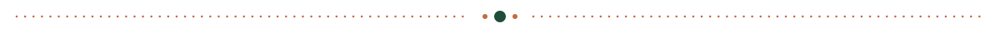
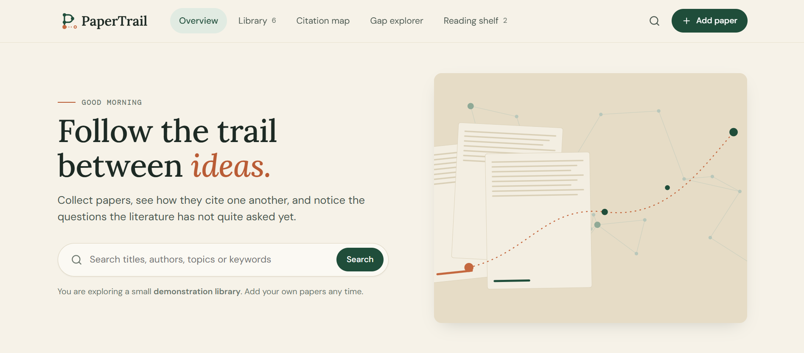
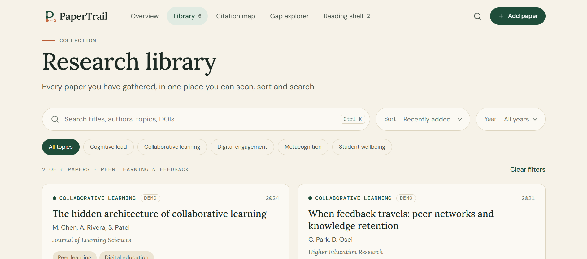

<p align="center">
  
</p>

<p align="center">
  <b>A research workspace for collecting papers, mapping how they cite one another,<br>and exploring questions the literature may not have asked yet.</b>
</p>

<p align="center">
  
  
  
  
  
</p>

<p align="center">
  <a href="#-features">Features</a> ·
  <a href="#-screenshots">Screenshots</a> ·
  <a href="#-getting-started">Getting started</a> ·
  <a href="#-how-the-citation-map-works">Citation map</a> ·
  <a href="#️-known-limitations">Limitations</a> ·
  <a href="CONTRIBUTING.md">Contributing</a>
</p>

<p align="center"></p>

> **Demonstration data.** PaperTrail ships with a small sample library. The titles, authors, journals, DOIs and citation counts are illustrative and do not refer to real publications. Papers you add yourself are stored in your browser only and are not verified against any source.

## 🔭 Overview

PaperTrail is a React and Vite app that treats a literature collection as a connected map rather than a flat list. Browse and search papers, open a detailed view of each one, see which papers reference which, and explore sample research directions that sit between topics in your collection.

It has no backend and needs no API keys.

<p align="center">
  
</p>

## ✨ Features

| Area | What it does |
| --- | --- |
| **Overview** | Welcome area with search, a continue-reading shortlist, featured collections, a citation network preview, saved papers and recent session activity. |
| **Research library** | Paper cards with title, authors, journal, year, DOI and keywords. Live search with highlighting, sorting (recent, year, most cited, title), year and topic filters, collection filters and clear no-result states. |
| **Paper details** | Abstract, keywords, DOI (with copy), citation links inside your collection, related papers and bookmarking. |
| **Citation map** | Force-laid-out network with directed citation arrows, dashed shared-keyword links, node size by reported citations, an information panel, a legend, and zoom and pan. |
| **Gap explorer** | Hand-written sample research directions with supporting papers and a live count of citation links between the two topics in your collection. Clearly labelled as exploratory. |
| **Reading shelf** | Saved papers with remove, undo, clear shelf and an empty state. |
| **Add papers** | Enter a paper by hand and tick which library papers it references, so it appears on the map with its links. |

<details>
<summary><b>Interaction, motion and accessibility details</b></summary>

- Horizontal navigation with an animated active indicator and a mobile menu.
- Page transitions, staggered cards, modal springs, animated bookmarks, drawn citation edges, skeleton loaders and toasts.
- `prefers-reduced-motion` is respected throughout.
- Skip link, visible focus states, labelled controls, focus-trapped modals that close with `Esc`, and keyboard-selectable map nodes.
- Shortcut: `Ctrl/Cmd + K` or `/` jumps to library search.

</details>

## 🖼 Screenshots

<table>
  <tr>
    <td width="50%"><b>Overview</b><br></td>
    <td width="50%"><b>Research library</b><br></td>
  </tr>
  <tr>
    <td width="50%"><b>Citation map</b><br></td>
    <td width="50%"><b>Gap explorer</b><br></td>
  </tr>
  <tr>
    <td width="50%"><b>Reading shelf</b><br></td>
    <td width="50%"></td>
  </tr>
</table>

## 🕸 How the citation map works

<p align="center">
  
</p>

- **Nodes** are papers. Size reflects reported citation count, colour reflects topic cluster, and the number inside is the publication year.
- **Solid arrows** point from a citing paper to the paper it cites. These come from the sample data, or from the references you tick when adding a paper.
- **Dashed lines** connect papers that share keywords but do not cite each other.
- **Select a node** to highlight its neighbours and open its details. Scroll to zoom and drag to pan.
- The layout is computed in the browser by a small force simulation, so papers you add appear automatically.

## 🚀 Getting started

Requires **Node.js 18 or newer**.

<p align="center">
  
</p>

```bash
git clone https://github.com/rheillunio2-byte/PaperTrail.git
cd PaperTrail
npm install
npm run dev
```

Open the local URL that Vite prints (usually `http://localhost:5173`).

| Command | Description |
| --- | --- |
| `npm run dev` | Start the development server |
| `npm run build` | Create a production build in `dist/` |
| `npm run preview` | Serve the production build locally |

## 🧰 Technology stack

<p align="center">
  
</p>

Design tokens live in `src/styles/tokens.css`. Fonts (Lora, DM Sans, DM Mono) load from Google Fonts with system fallbacks.

## 🎨 Brand

Original SVG assets live in `public/brand/`:

| File | Use |
| --- | --- |
| `papertrail-logo.svg` | Full logo for light backgrounds (navigation, footer) |
| `papertrail-logo-light.svg` | Full logo for dark backgrounds (loading screen) |
| `papertrail-icon.svg` | Standalone symbol |
| `papertrail-favicon.svg` | Simplified tab icon that adapts to dark browser themes |

The symbol is a letter P drawn as a citation trail: nodes along a path, with a dotted trail continuing from the base. The wordmark is outlined from Lora SemiBold (SIL Open Font License), so no font is needed to display the logo.

Original illustrations used in the app are in `public/images/`. The animated graphics in this README live in `docs/`. They respect `prefers-reduced-motion` and show their final state when motion is reduced.

## 🗂 Project structure

```text
PaperTrail/
├── docs/                   README and CONTRIBUTING animated SVGs
├── images/                 README screenshots
├── public/
│   ├── brand/              SVG logo, icon, light logo, favicon
│   └── images/             original in-app illustrations
├── src/
│   ├── main.jsx            entry point
│   ├── App.jsx             hash routing, state, modals, toasts
│   ├── data/seed.js        DEMO records, collections, sample research directions
│   ├── lib/                graph layout and analysis, persistence hooks
│   ├── components/         Nav, PaperCard, PaperDetail, AddPaper, CitationMap, UI primitives
│   ├── views/              Overview, Library, Connections, Gaps, Shelf
│   └── styles/             tokens.css, app.css
├── index.html
├── vite.config.js
└── package.json
```

## ⚠️ Known limitations

- **Demonstration data only.** There is no research database, live academic indexing or automatic citation extraction. Metadata you enter is not verified.
- **Citation links are manual.** Links among the sample papers are illustrative. For your own papers, links come from the references you select when adding them.
- **Gap directions are sample hypotheses.** The link counts are real counts over the papers in your library, but a low count does not prove a gap in the literature. Check the wider literature before drawing conclusions.
- **Storage is local.** Added papers, the shelf, recent items and saved directions persist in this browser's `localStorage` only. There is no sync, export, or editing of existing papers yet.
- **Fonts need a connection** the first time they load. System fonts are used as a fallback.

## 🛣 Roadmap

- [ ] Metadata lookup through Crossref or OpenAlex
- [ ] BibTeX and CSV export
- [ ] Editing and deleting papers
- [ ] Persistent storage and accounts
- [ ] Dark theme

Ideas and pull requests are welcome.

## ❓ FAQ

<details>
<summary><b>Are the papers in the demo real?</b></summary>

No. Titles, authors, journals, DOIs and citation counts are illustrative samples. Their DOIs are not live identifiers, so the app does not link them externally. Papers you add yourself can carry a real DOI, which then links to doi.org.

</details>

<details>
<summary><b>Does PaperTrail find research gaps automatically?</b></summary>

No. The gap explorer shows hand-written sample directions. The only calculated part is a count of citation links between two topics among the papers in your library. A low count may simply mean a paper is not in your library.

</details>

<details>
<summary><b>Where is my data stored?</b></summary>

In your browser's `localStorage`. Nothing is sent to a server, and clearing site data removes it.

</details>

<details>
<summary><b>Can I turn animations off?</b></summary>

PaperTrail follows your operating system's reduced-motion setting. Enable it and transitions are shortened or removed, and the README graphics show their final state.

</details>

<p align="center"></p>

## 🤝 Contributing

Contributions are welcome. Please read [CONTRIBUTING.md](CONTRIBUTING.md) first.

## 📄 License

Released under the [MIT License](LICENSE). See the `LICENSE` file for the full text and copyright notice.

<p align="center"><sub>Follow the trail between ideas.</sub></p>
